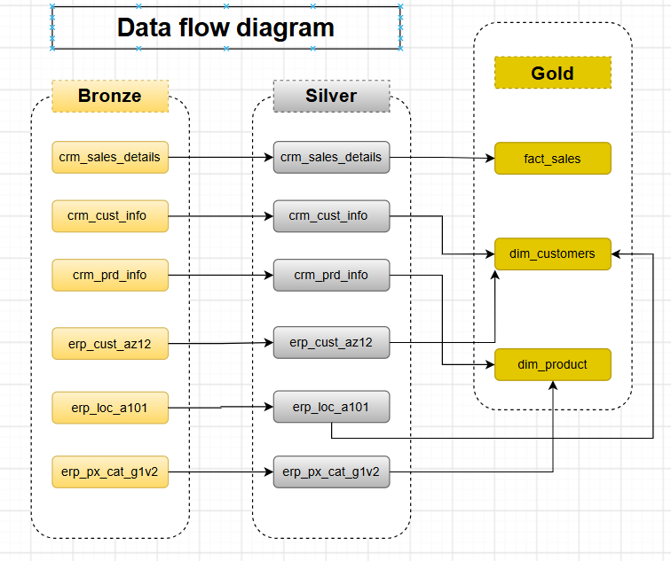
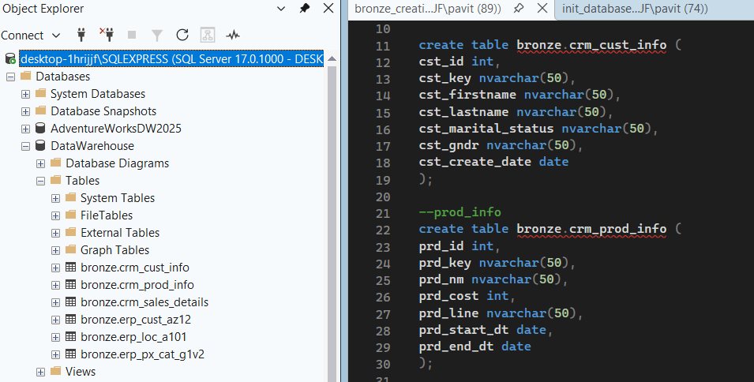
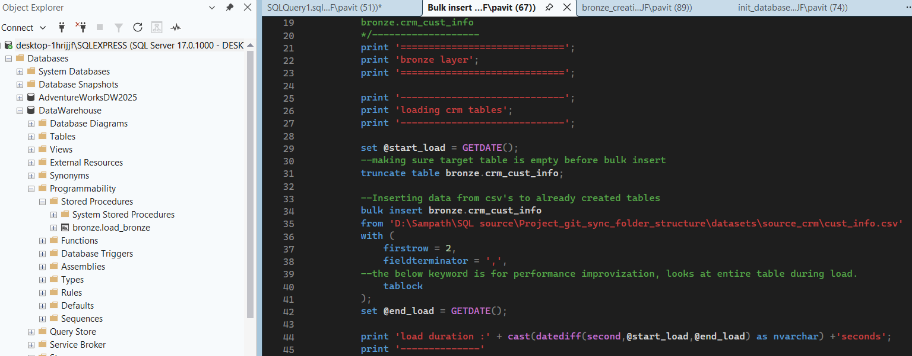
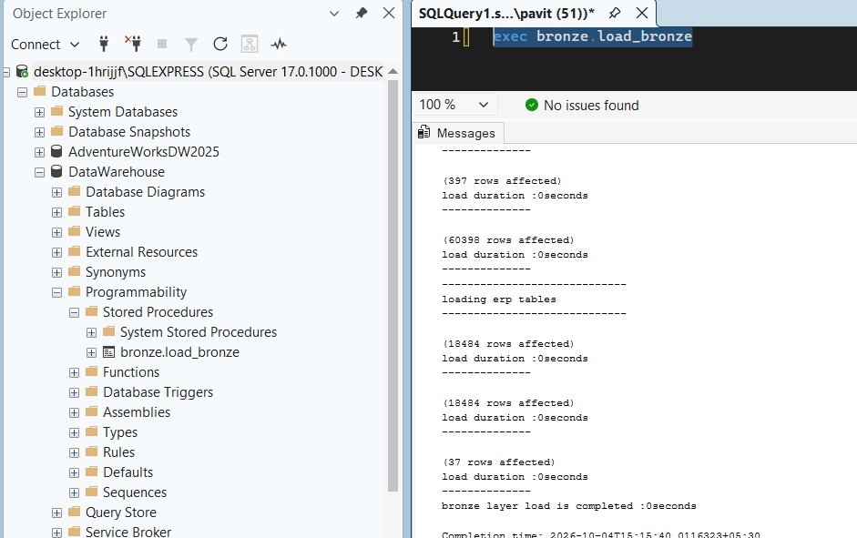
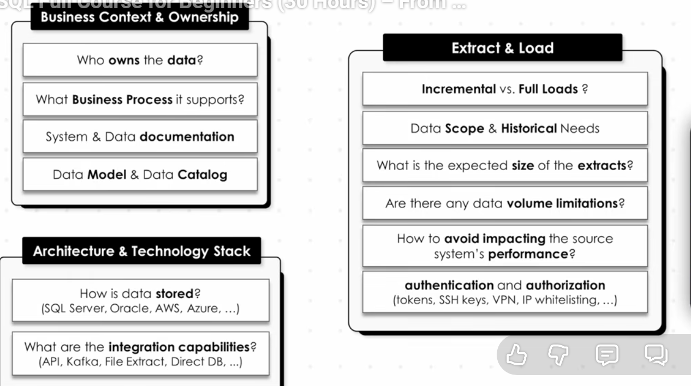
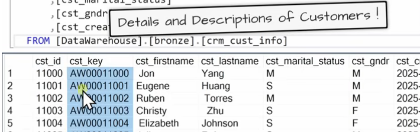
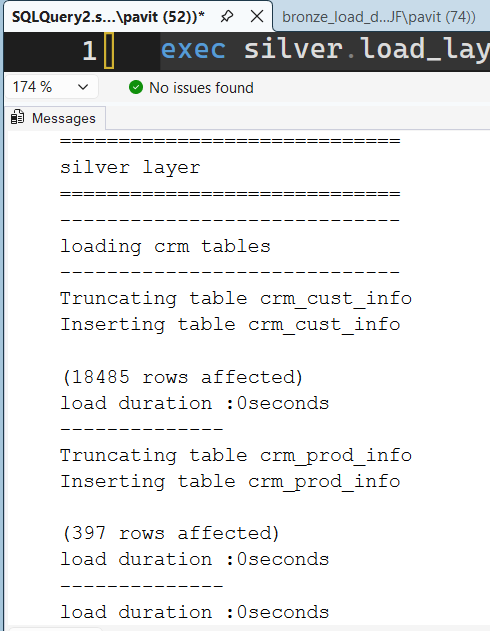
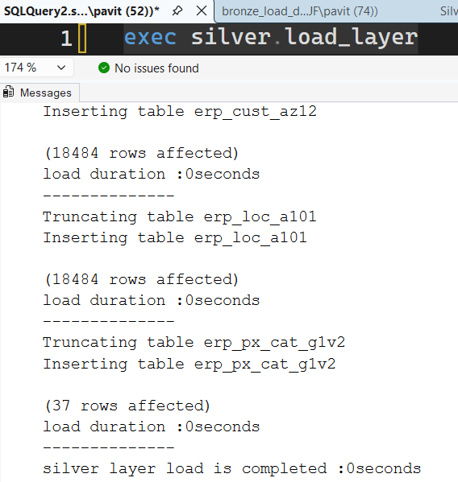
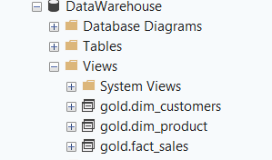

# Data Warehouse Project

Welcome to the **Data Warehouse** repository! 🚀  
This project demonstrates a comprehensive data warehousing solution. Designed as a portfolio project, it highlights industry best practices in data engineering.

---
## 🏗️ Data Architecture

The data architecture for this project follows Medallion Architecture **Bronze**, **Silver**, and **Gold** layers:

<table>
  <tr>
    <th align="center">Data Architecture</th>
  </tr>
  <tr>
    <td align="center"></td>
  </tr>
</table>

1. **Bronze Layer**: Stores raw data as-is from the source systems. Data is ingested from CSV Files into SQL Server Database.
2. **Silver Layer**: This layer includes data cleansing, standardization, and normalization processes to prepare data for analysis.
3. **Gold Layer**: Houses business-ready data modeled into a star schema required for reporting and analytics.

---
## 📖 Project Overview

This project involves:

1. **Data Architecture**: Designing a Modern Data Warehouse Using Medallion Architecture **Bronze**, **Silver**, and **Gold** layers.
2. **ETL Pipelines**: Extracting, transforming, and loading data from source systems into the warehouse.
3. **Data Modeling**: Developing fact and dimension tables optimized for analytical queries.

---

## 🚀 Project Requirements

### Building the Data Warehouse (Data Engineering)

#### Objective
Develop a modern data warehouse using SQL Server to consolidate sales data, for downstream reporting and informed decision-making.

#### Specifications
- **Data Sources**: Import data from two source systems (ERP and CRM) provided as CSV files.
- **Data Quality**: Cleanse and resolve data quality issues prior to analysis.
- **Integration**: Combine both sources into a single, user-friendly data model designed for analytical queries.
- **Scope**: Focus on the latest dataset only; historization of data is not required.
- **Documentation**: Provide clear documentation of the data model to support both business stakeholders and analytics teams.

---

## 📂 Repository Structure
```
data-warehouse-project/
│
├── datasets/                           # Raw datasets used for the project (ERP and CRM data)
│
├── design/                                 # Project documentation and architecture details
│   ├── Data_flow_diagram.drawio            # Draw.io file for the data flow diagram
│   ├── Integration_model.drawio            # Catalog of datasets, including field descriptions and metadata
│   ├── Project_high_level_design.drawio    # Macro view
│   ├── star_data_model.drawio                # 
│
├── scripts/                                # SQL scripts for ETL and transformations
│   ├── bronze/                             # Scripts for extracting and loading raw data
│   ├── silver/                             # Scripts for cleaning and transforming data
│   ├── gold/                               # Scripts for creating analytical models
│
├── README.md                               # Project overview and instructions
└── LICENSE                                 # License information for the repository
```
---

## Project releated snips

<table>
  <tr>
    <th align="center">Bronze Creating Tables</th>
    <th align="center">Bronze Loading Data</th>
    <th align="center">Bronze Stored Procedure</th>
    <th align="center">Bronze Layer Questionnaire</th>
    <th align="center">SL Understanding data</th>
    <th align="center">SL stored procedure 1</th>
    <th align="center">SL stored procedure 2</th>
    <th align="center">Gold Views for downstream</th>
  </tr>
  <tr>
    <td align="center"></td>
    <td align="center"></td>
    <td align="center"></td>
    <td align="center"></td>
    <td align="center"></td>
    <td align="center"></td>
    <td align="center"></td>
    <td align="center"></td>
  </tr>
</table>

## 🛡️ License

This project is licensed under the [MIT License](LICENSE.txt). You are free to use, modify, and share this project with proper attribution.